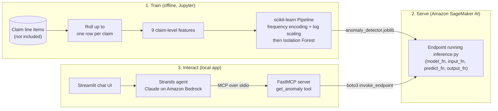

# Anomaly Detection

**A simple, textbook example of anomaly detection, built end to end: an unsupervised model that flags unusual healthcare claims for human review. It starts with feature engineering in Jupyter, serves the model from Amazon SageMaker AI, and wraps it in a conversational AI agent that queries it.**


> **Demo / proof of concept.** All data used in this project is synthetic, and the model is not production-ready. A flagged claim is a prompt for human review, **not** a finding of fraud.

## At a glance

| | |
|---|---|
| **Problem** | Surface unusual claims worth a human review when there is no "fraud" label to learn from |
| **Approach** | Unsupervised learning: an Isolation Forest trained on engineered, claim-level features |
| **Delivery** | Model hosted on an Amazon SageMaker AI endpoint and queried in plain English through an AI agent (Claude on Amazon Bedrock), which calls it via the Model Context Protocol (MCP) |
| **Stack** | Python · pandas · scikit-learn · category_encoders · Amazon SageMaker AI · Amazon Bedrock · Strands Agents · FastMCP · Streamlit · uv |

## Why I built this

My goal was a simple, textbook example of anomaly detection that shows how machine learning could be leveraged in our work. I also built it as a professional development project. It takes one model through the full lifecycle: data preparation, feature engineering, training, cloud deployment, and an AI-powered interface on top.

## What this project demonstrates

- **Data preparation:** checks which fields stay constant within a claim, then rolls raw line-item records up to one row per claim with pandas.
- **Feature engineering:** frequency (count) encoding of high-cardinality IDs, followed by log scaling. The model sees *how busy* a doctor, patient, or practice is, not *which* one it is.
- **Unsupervised machine learning:** an Isolation Forest whose `contamination` rate is tied to an assumed review capacity (1% of claims).
- **Reproducible pipelines:** preprocessing and model are packaged as a single scikit-learn `Pipeline` and serialized with joblib, so serving runs exactly the same transformations as training.
- **Model deployment:** custom Amazon SageMaker AI inference handlers. They validate input, accept JSON and CSV, and check at startup that the deployed model's features match the serving code.
- **Agentic AI:** an agent built with Strands Agents and running Claude on Amazon Bedrock. It calls the model endpoint through a tool exposed by an MCP server.
- **Responsible framing:** outputs are presented as leads for review, not verdicts. The agent is instructed to ground its answers in the endpoint's results.
- **Transparent AI-assisted development:** see [How AI was used](#how-ai-was-used).

## Architecture



**How the pieces fit together**

1. **Train (offline).** The notebook turns raw claim line items into one row per claim and engineers nine features. It then fits a scikit-learn `Pipeline` (frequency encoding, log scaling, Isolation Forest) and saves the whole pipeline as a single joblib file.
2. **Serve.** The saved pipeline is deployed to an Amazon SageMaker AI endpoint. `inference.py` loads it, validates each request, and returns an anomaly score and a flag for every claim.
3. **Interact.** A user chats with the agent in Streamlit. The agent, built with Strands Agents and running Claude on Amazon Bedrock, decides when to call the `get_anomaly` tool. That tool lives in a FastMCP server, which the agent starts as a local subprocess and talks to over MCP. The tool calls the SageMaker AI endpoint with `boto3` and returns the flagged claims. The agent then presents them as a table for review.

## How it works

### 1. Data preparation and feature engineering (`anomaly_detection.ipynb`)

The raw data has one row per claim **line item** (one billed service), so the same claim appears on many rows. The notebook first checks which fields are constant within a claim. It then rolls the line items up to **one row per claim** and derives three count features. The model uses nine features:

| Feature | Type | What it measures | Unusual activity it can surface |
|---|---|---|---|
| `CLAIM_DOLLAR_AMOUNT_PAID` | numeric | What was paid for the claim | Unusually expensive claims |
| `CLAIM_SERVICES_FULL_SUBMISSION` | numeric | What the doctor billed | Billing far more than usual |
| `n_lines` | numeric (derived) | Number of line items on the claim | Claims padded with extra items |
| `n_services` | numeric (derived) | Total units of service billed | Billing for more services than usual |
| `n_examinations` | numeric (derived) | Number of examination codes listed (up to 12) | Unusually high or low examination counts |
| `PATIENT_ID` | frequency-encoded | How many claims the patient has | A patient billed far more often than others |
| `DOCTOR_ID` | frequency-encoded | How many claims the doctor has | Unusually high or low doctor volume |
| `PRACTICE_ID` | frequency-encoded | How many claims the practice has | Unusual billing volume for a single practice |
| `PRIMARY_EXAMINATION_CODE` | frequency-encoded | How common the main examination is | Unusually rare or overused examinations |

**Frequency encoding.** IDs and codes are labels, not quantities. Each one is replaced with the number of claims it appears in (count encoding with `category_encoders.CountEncoder`), and that count is log-scaled with `log1p`. The model therefore looks at volume rather than identity. A high count is not treated as suspicious in itself; it is one signal among several. Dollar amounts and item counts pass through unchanged.

### 2. Model: Isolation Forest

No column marks a claim as fraudulent, so this is an **unsupervised** problem. The notebook uses scikit-learn's Isolation Forest, which isolates observations with random splits. Unusual claims get separated in fewer splits (shorter path lengths) than typical ones.

- `n_estimators=200`, and `random_state=23` so results are reproducible.
- `contamination=0.01` (`REVIEW_SHARE`) sets the decision threshold so that about 1% of training claims are flagged. In practice this number would come from reviewers' actual capacity; 1% is an assumption.
- Preprocessing and model form one `Pipeline` (a `ColumnTransformer` followed by `IsolationForest`), saved with joblib.

After training, the notebook does three things:

- It scores every claim (`anomaly_score = -decision_function`, so higher means more anomalous) and flags the outliers.
- It compares the median flagged claim with the median typical claim, feature by feature, in readable units.
- It rolls flags up by doctor to suggest which doctors' claims to review first.

The model scores **claims**, not doctors, patients, or practices. The doctor roll-up only helps prioritize reviews.

### 3. Deployment: Amazon SageMaker AI (`sagemaker_deployment/`)

`inference.py` implements SageMaker's inference handler functions:

| Function | Runs | What it does |
|---|---|---|
| `model_fn` | Once, at startup | Loads `anomaly_detector.joblib` and verifies that the model's feature names and order match the serving code |
| `input_fn` | Every request | Accepts JSON (a single claim or a list) or headerless CSV. Checks for required columns, forces numeric fields to numbers, and rejects missing or invalid values |
| `predict_fn` | Every request | Scores the claims and returns `anomaly_score` and `flagged`, echoing `DOCTOR_ID` and, if provided, `CLAIM_ID` |
| `output_fn` | Every request | Returns JSON (`{"predictions": [...]}`) or CSV, depending on the requested content type |

`requirements.txt` pins scikit-learn, category_encoders, pandas, NumPy, joblib, and PyArrow to the exact versions the model was saved with. Pickled models only load reliably on the same library versions.

Example request body (`application/json`), using one claim from the agent's stock payload:

```json
[
  {
    "CLAIM_ID": 1004,
    "CLAIM_DOLLAR_AMOUNT_PAID": 25000.00,
    "CLAIM_SERVICES_FULL_SUBMISSION": 31000.00,
    "n_lines": 20,
    "n_services": 300,
    "n_examinations": 12,
    "PATIENT_ID": 2004,
    "DOCTOR_ID": 3004,
    "PRACTICE_ID": 4004,
    "PRIMARY_EXAMINATION_CODE": "A1"
  }
]
```

The JSON response has one entry per claim, in request order. Each entry contains `CLAIM_ID` (when sent), `DOCTOR_ID`, `anomaly_score` (a float), and `flagged` (a boolean).

### 4. Application: agent, MCP server, and UI (`app/`)

- **Streamlit UI** (`app/ui/app.py`): a chat interface. The agent and the chat history are kept in Streamlit session state.
- **Strands agent** (`app/agent/agent.py`): Claude Sonnet 5.5 on Amazon Bedrock. Its system prompt sets out:
  - the scope of the demo;
  - the request payload contract, so the agent can help users validate data they paste in;
  - a stock payload for an instant demo;
  - the output format, a table of flagged Claim ID / Doctor ID pairs.

  It is also instructed that a flagged claim is not automatically fraud.
- **MCP server** (`app/mcp/anomaly_detector_server.py`): a FastMCP server that the agent launches as a subprocess and talks to over stdio. Its single tool, `get_anomaly`, sends the given payload (or the stock payload) to the SageMaker AI endpoint and returns only the flagged Claim ID / Doctor ID pairs.

## Tech stack

| Area | Tools |
|---|---|
| Language and tooling | Python 3.12, uv, JupyterLab |
| Data and ML | pandas, NumPy, scikit-learn (`IsolationForest`, `Pipeline`, `ColumnTransformer`), category_encoders, joblib, Matplotlib |
| Model hosting | Amazon SageMaker AI (custom inference script), boto3 |
| Generative AI | Strands Agents, Claude Sonnet 5.5 on Amazon Bedrock |
| Tool integration | Model Context Protocol (MCP) via FastMCP |
| User interface | Streamlit |

## Repository structure

```
.
├── anomaly_detection.ipynb            # Feature engineering and model training (outputs intentionally cleared)
├── sagemaker_deployment/
│   ├── inference.py                   # Amazon SageMaker AI inference handlers
│   └── requirements.txt               # Serving dependencies, pinned to the training versions
├── app/
│   ├── ui/app.py                      # Streamlit chat UI
│   ├── agent/agent.py                 # Strands agent (Claude on Amazon Bedrock) and system prompt
│   └── mcp/anomaly_detector_server.py # FastMCP server exposing the get_anomaly tool
├── data/                              # Dataset intentionally not included (see data/README.md)
├── pyproject.toml, uv.lock            # Dependencies, managed with uv
└── LICENSE
```

## Data availability

The dataset is **intentionally not included** in this repository.

- **Synthetic, but not redistributed.** The project was built on synthetic data. Even so, I chose not to publish the dataset.
- **Column names replaced.** Every column name was changed from its original name. The names in this repository are stand-ins.
- **Notebook outputs removed.** For the same reason, all notebook cell outputs were cleared before publishing.

[`data/README.md`](data/README.md) describes the input format the notebook expects.

## Getting started

The dataset isn't included and the app depends on AWS resources, so this repository is mainly meant to be read. The steps below show how to run it with your own data and AWS account.

### Prerequisites

- Python 3.12+ and [uv](https://docs.astral.sh/uv/)
- **To train:** a dataset in the format described in [`data/README.md`](data/README.md)
- **To run the app:** an AWS account with access to Claude Sonnet 5.5 in Amazon Bedrock, and a deployed SageMaker AI endpoint with an inference component. The code targets `us-east-1` for both.

### 1. Install

```bash
git clone https://github.com/alxmel/detecting_fraud_example.git
cd detecting_fraud_example
uv sync
```

### 2. Train the model

```bash
uv run jupyter lab
```

Open `anomaly_detection.ipynb`. Set `DATA_PATH` in the first code cell and the output path in the `joblib.dump(...)` cell, then run all cells. The serving code expects the saved file to be named `anomaly_detector.joblib`.

### 3. Deploy to Amazon SageMaker AI

Deploy the saved model to a SageMaker AI endpoint. Use `sagemaker_deployment/inference.py` as the inference script and `sagemaker_deployment/requirements.txt` for its dependencies. Provisioning is not scripted in this repository; that includes packaging the model and creating the endpoint and inference component.

### 4. Run the app

1. Set your endpoint and inference component names (`EndpointName`, `InferenceComponentName`) in `app/mcp/anomaly_detector_server.py`.
2. Export your AWS credentials as `AWS_*` environment variables. The agent passes these through to the MCP server process, which otherwise receives only a few basic environment variables.
3. Start the app:

```bash
cd app/ui
uv run streamlit run app.py
```

Run it from `app/ui` so Streamlit picks up `app/ui/.streamlit/config.toml`, which turns off usage-statistics collection. Ask the agent to run the stock payload, or paste your own claims as JSON and let it check them against the payload contract.

## How AI was used

I want to be upfront about where AI helped in this project and where it didn't. Using AI tools well is part of what this project is meant to show.

| Part of the project | How AI was used |
|---|---|
| **Notebook: EDA and feature engineering** (`anomaly_detection.ipynb`) | I consulted an AI assistant for general guidance. The data was very complex, and AI helped me work through the exploratory data analysis (EDA) and feature engineering phases. EDA was done in a separate notebook that isn't included in this repository. |
| **SageMaker AI inference script** (`sagemaker_deployment/inference.py`) | I consulted an AI assistant for help with the inference script used to deploy the model to Amazon SageMaker AI. |
| **Application code: agent, MCP server, and UI** (`app/`) | Written without AI assistance. The agent does use Claude on Amazon Bedrock when it runs, but that is a feature of the app, not help in writing it. |
| **UI logo** (`app/ui/image/logo.jpeg`) | Generated with Google generative AI, as recorded in the image's embedded C2PA Content Credentials. |
| **Documentation** (`README.md`, `data/README.md`) | Drafted with Claude Code. |

The application also shows generative AI and traditional machine learning working together. An LLM agent handles the conversation and calls the Isolation Forest model through MCP to do the detection.

## Limitations

- **Demo only.** The data is synthetic and the model is a proof of concept, not a production system.
- **No ground truth.** Without fraud labels, the model can't be scored with metrics such as precision or recall. Flags are leads for human review, not findings.
- **Assumed review capacity.** The 1% flag rate is an assumption. In practice it would be set by how many claims reviewers can actually handle.
- **Training-time volumes.** Frequency features reflect claim counts in the training data. IDs that weren't in the training data are treated as never seen.
- **Manual deployment.** Endpoint names are placeholders, and deployment to SageMaker AI is not automated here.

## References

- scikit-learn: [Isolation Forest (User Guide)](https://scikit-learn.org/stable/modules/outlier_detection.html#isolation-forest) and [`IsolationForest` API reference](https://scikit-learn.org/stable/modules/generated/sklearn.ensemble.IsolationForest.html)
- F. T. Liu, K. M. Ting, and Z.-H. Zhou, "[Isolation Forest](https://doi.org/10.1109/ICDM.2008.17)," *2008 Eighth IEEE International Conference on Data Mining (ICDM)*, pp. 413–422.
- scikit-learn: [Encoding categorical features](https://scikit-learn.org/stable/modules/preprocessing.html#encoding-categorical-features)
- category_encoders: [`CountEncoder`](https://contrib.scikit-learn.org/category_encoders/count.html)
- AWS: [Resources for using Scikit-learn with Amazon SageMaker AI](https://docs.aws.amazon.com/sagemaker/latest/dg/sklearn.html) and [Amazon SageMaker AI adds Scikit-Learn support](https://aws.amazon.com/blogs/machine-learning/amazon-sagemaker-adds-scikit-learn-support/)
- AWS: [Amazon Bedrock User Guide](https://docs.aws.amazon.com/bedrock/latest/userguide/what-is-bedrock.html)
- Strands Agents: [SDK repository](https://github.com/strands-agents/sdk-python) and [MCP tools guide](https://strandsagents.com/latest/documentation/docs/user-guide/concepts/tools/mcp-tools/)
- [Model Context Protocol](https://modelcontextprotocol.io/) and [FastMCP](https://gofastmcp.com/)
- Streamlit: [Chat elements](https://docs.streamlit.io/develop/api-reference/chat)

## License

Released under the [MIT License](LICENSE).
